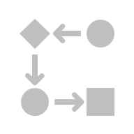

# Guía de Aprendizaje — Sumativa Unidad 2

> Contenido convertido desde `TI3042_U2_ES_GUÍA.docx`. Se conserva el orden y la informaci?n del documento original.

Guía de Aprendizaje - Sumativa Unidad 2
Aplicaciones Móviles para IoT
TI3042
Guía de Aprendizaje - Sumativa Unidad 2
Aplicaciones Móviles para IoT
TI3042

| Unidad 2                                                                                                                                                                                                                                                                                                                                                                                                                                          |
| ------------------------------------------------------------------------------------------------------------------------------------------------------------------------------------------------------------------------------------------------------------------------------------------------------------------------------------------------------------------------------------------------------------------------------------------------- |
| Aplicaciones Móviles Android                                                                                                                                                                                                                                                                                                                                                                                                                     |
| Aprendizaje Esperado                                                                                                                                                                                                                                                                                                                                                                                                                              |
| 2.1 Resuelve una problemática para la interconexión de dispositivos IoT, mediante el desarrollo de una aplicación móvil seleccionando la solución más pertinente para el análisis realizado.                                                                                                                                                                                                                                               |
| Criterios de Evaluación                                                                                                                                                                                                                                                                                                                                                                                                                          |
| 2.1.1 Identifica herramientas de desarrollo móvil, siguiendo estándar de diseño de aplicaciones Android.2.1.2 Produce aplicación móvil Android, con uso de conexiones inalámbricas de la forma más pertinente a problemática planteada.2.1.3 Emplea estándar ISO de seguridad de aplicaciones IOT, siguiendo el lineamiento de industria OT.2.1.4 Demuestra interconexión entre aplicaciones móviles, mediante conexión inalámbrica. |

Para esta actividad cuentas con 6 semanas.

**Evaluación de tipo:** Individual

**Instrumento de evaluación:** Sumativa (25 %)

**Descripción:** Los estudiantes de forma individual desarrollan una aplicación móvil.

Para esta actividad cuentas con 6 semanas.

**Evaluación de tipo:** Individual

**Instrumento de evaluación:** Sumativa (25 %)

**Descripción:** Los estudiantes de forma individual desarrollan una aplicación móvil.

## Presentación

El Internet de las Cosas (IoT) está revolucionando la forma en que interactuamos con el mundo que nos rodea. Desde hogares inteligentes hasta ciudades conectadas, la capacidad de los dispositivos para comunicarse entre sí y con nosotros está creando nuevas oportunidades y desafíos en diversas industrias. En el ámbito educativo, el IoT ofrece una plataforma emocionante para que los estudiantes desarrollen habilidades prácticas y teóricas en tecnología y programación.

En este contexto, se propone desarrollar una aplicación móvil (APK) de forma individual, basada en una problemática seleccionada, integrando lineamientos para la industria OT. A lo largo de las unidades, los estudiantes realizarán actividades que contribuirán al desarrollo de esta aplicación, la cual será el entregable principal de la Unidad 4. Esta actividad no solo fortalecerá sus habilidades en programación móvil, sino que también les permitirá comprender cómo estas aplicaciones pueden integrarse en entornos industriales y operativos.

En esta Unidad en particular, cada estudiante construirá una aplicación móvil utilizando Android Studio. La aplicación deberá ser funcional y demostrar su operatividad en un dispositivo Android. Se recomienda que la temática o contexto de la aplicación esté alineado con el proyecto final del curso. La entrega de esta aplicación corresponderá a la evaluación sumativa de la Unidad 2, la cual será evaluada mediante una escala de apreciación, la cual establece los estándares mínimos de cumplimiento para la actividad.

Además, se contempla una preentrega como parte de la evaluación formativa, que consistirá en un avance de la evaluación sumativa. Esta preentrega será evaluada con el instrumento lista de cotejo, permitiendo a los estudiantes recibir retroalimentación antes de la entrega final.

## Instrucciones generales

- Para el desarrollo de esta unidad podrán seguir con los equipos formados en la unidad anterior. Pero recordando que se trabajará de forma individual.
- Cada equipo debe seguir con el problema planteado en la unidad anterior, pues se desarrollará durante toda la asignatura, involucrando las 4 unidades.
- Cada proyecto deberá involucrar el desarrollo de una aplicación móvil que permita interactuar al menos a dos dispositivos Android, ya sea mediante conectividad WiFi o Bluetooth.
- Dado lo anterior, cada grupo presentará las funcionalidades que deberá abordar la aplicación móvil, la cual debe ser validada por el docente.
- El foco principal de esta entrega sumativa es desarrollar una aplicación móvil que pueda ser desplegada en al menos dos dispositivos Android, simulando funcionalidades de control y monitoreo de dispositivos IoT.
- Se sugiere revisar el instrumento de evaluación. Esto les permitirá tener claridad de los aspectos que serán evaluados, optimizar los tiempos y priorizando las actividades que permitan alcanzar los plazos dados y la meta fijada para esta unidad de aprendizaje.

## Actividades para la evaluación

### Se deben desarrollar las siguientes tareas en esta segunda unidad:

## Paso 1: Definir el proyecto:

### Identificación de la problemática:

Piensa en la problemática que trataste en la unidad anterior. ¿Qué dispositivos o sistemas necesitas conectar? ¿Cuál es el objetivo de la comunicación entre estos dispositivos? A partir de esta reflexión, define las funcionalidades clave que debe tener tu aplicación para resolver esta problemática. Piensa en aspectos como qué tipo de interacción quieres lograr (enviar o recibir datos, controlar dispositivos, etc.) y qué características debería tener la app para ser efectiva.

### Selección de herramientas de desarrollo:

La aplicación será desarrollada en Android Studio con Kotlin. Especifica qué herramientas y bibliotecas adicionales utilizarás para integrar la conectividad con dispositivos IoT y la autenticación de usuarios. Las opciones para el almacenamiento y gestión de datos incluyen SQLite, Firebase, MySQL o APIs externas. Justifica tu elección con base en estándares de desarrollo de aplicaciones Android y en la interoperabilidad de los datos capturados por los sensores.

### Revisión con el docente:

Una vez que tengas claro qué herramientas usarás y qué funcionalidades tendrá tu aplicación, comparte tu idea con el docente. El docente te dará retroalimentación sobre la factibilidad de tu plan y si está alineado con los criterios de evaluación, para asegurarse de que estés en el camino correcto.

## Paso 2: Diseñar la solución:

### Definir el método de comunicación inalámbrica:

Elige la tecnología que permitirá la conexión entre la aplicación móvil y los dispositivos IoT, como Bluetooth, Wi-Fi o MQTT. Justifica tu selección en función de la distancia, el consumo de energía y la estabilidad de la conexión.

### Diseñar la pantalla de login y definir el sistema de autenticación:

La aplicación deberá implementar una pantalla de autenticación mediante credenciales (usuario y contraseña). Define cómo se gestionará el login, eligiendo entre:

- SQLite (local): Para autenticación sin conexión.
- Firebase Authentication (nube): Para autenticación con Google, correo y contraseña.
- API con MySQL: Para autenticación mediante un backend externo.

Justifica tu elección según la seguridad, escalabilidad y facilidad de implementación.

### Diseñar la interfaz de usuario (UI):

Elabora un mockup de la aplicación, detallando las pantallas principales, la navegación y la interacción con los dispositivos IoT. Incluye cómo se visualizarán los datos capturados y cómo el usuario podrá interactuar con los dispositivos conectados.

### Revisión con el docente:

Comparte el diseño y la estructura del sistema de autenticación con el docente para asegurar que cumple con los estándares de la industria y los criterios de evaluación.

## Paso 3: Construir la aplicación:

### Desarrollar la pantalla de login y la autenticación de usuarios:

Implementa el sistema de autenticación seleccionado, asegurando que los datos de usuario sean almacenados y validados correctamente. Si se usa una API, programa la conexión entre la aplicación y la base de datos externa.

### Configurar la conexión con dispositivos IoT y el almacenamiento de datos:

Implementa el mecanismo de almacenamiento para los datos capturados por los sensores. La aplicación debe permitir consultar estos datos desde diferentes fuentes:

- Bases de datos locales (SQLite).
- Bases de datos en la nube (Firebase).
- APIs para MySQL u otros sistemas externos.

Asegúrate de que la solución elegida facilite la interoperabilidad con la aplicación móvil y la consulta de datos en tiempo real.

### Implementar medidas de seguridad IoT:

Sigue la norma ISO 27400 para proteger los datos y garantizar una conexión segura. Aplica prácticas como:

- Cifrado de credenciales y datos sensibles.
- Control de acceso y permisos adecuados.
- Uso de conexiones seguras (HTTPS, TLS, etc.).

### Pruebas de funcionamiento:

### Realiza pruebas en la aplicación para verificar que:

- El login funcione correctamente con el método de autenticación elegido.
- Se establezca la conexión con los dispositivos IoT sin errores.
- Los datos capturados sean almacenados y consultados correctamente.
- Se cumplan los estándares de seguridad y estabilidad.

## Paso 4: Presentación y validación

### Demostración en clase:

### Expón tu aplicación mostrando:

- El proceso de autenticación y cómo se gestionan los usuarios.
- La conexión entre la app y los dispositivos IoT.
- El almacenamiento y consulta de datos mediante la opción seleccionada.
- Las medidas de seguridad implementadas.

### Evaluación del docente:

El docente revisará la funcionalidad de la aplicación según los criterios de evaluación y la escala de apreciación. Se analizará la efectividad de la interconexión, la autenticación segura y la correcta manipulación de los datos. Si es necesario, se podrán realizar ajustes finales para optimizar el rendimiento y la seguridad de la aplicación.

## Indicaciones de entrega

| En la plataforma AAI se habilitará una tarea para que los estudiantes suban un bloc de notas con un link a GitHub con el código de la aplicación desarrollada. Esto deberá ser cargado en la fecha correspondiente, antes de que finalice la clase del día de la evaluación.Una vez finalizado el plazo, se bloqueará el acceso a subir la tarea.  Se recomienda evitar realizar la carga en el último minuto, dado que existe la posibilidad de fallas en el sistema y problemas de conexión que podrían surgir. Es aconsejable planificar con antelación para prevenir inconvenientes. NO SE RECIBIRÁN ENTREGAS POR CORREO. Aquellos que no asistan a las fechas de evaluación recibirán una calificación mínima, a menos que justifiquen su ausencia de acuerdo con los protocolos establecidos en el Reglamento Académico. Es necesario que informen oportunamente al docente a través de correo electrónico para validar su situación. |
| ------------------------------------------------------------------------------------------------------------------------------------------------------------------------------------------------------------------------------------------------------------------------------------------------------------------------------------------------------------------------------------------------------------------------------------------------------------------------------------------------------------------------------------------------------------------------------------------------------------------------------------------------------------------------------------------------------------------------------------------------------------------------------------------------------------------------------------------------------------------------------------------------------------------------------------------------------------------------- |

## Rubrica de evaluación

| 2.1.1.1. Implementa una pantalla de Login que permita el ingreso a la aplicación mediante credenciales (usuario y contraseña) utilizando herramientas de desarrollo móvil específicas para Android.                                                                                                         | Sí10 puntosNo0 puntos |
| --------------------------------------------------------------------------------------------------------------------------------------------------------------------------------------------------------------------------------------------------------------------------------------------------------------- | ---------------------- |
| 2.1.1.2. Desarrolla las pantallas de Monitoreo y Activador, aplicando correctamente los principios de diseño de Material Design y asegurando la funcionalidad de mostrar datos recibidos y enviar datos a otro dispositivo mediante elementos interactivos (editTexts, sliders, radioButtons, switches, etc.). | Sí10 puntosNo0 puntos |
| 2.1.2.3. La aplicación implementa conexiones inalámbricas (Bluetooth, Wi-Fi) de manera eficiente y segura, siguiendo los principios de buenas prácticas en conectividad.                                                                                                                                     | Sí15 puntosNo0 puntos |
| 2.1.2.4. Resuelve la problemática planteada utilizando las conexiones inalámbricas de forma innovadora y efectiva.                                                                                                                                                                                            | Sí10 puntosNo0 puntos |
| 2.1.3.5. Integra medidas de seguridad basadas en estándares ISO (e.g., ISO/IEC 27001) en la aplicación IoT.                                                                                                                                                                                                   | Sí10 puntosNo0 puntos |
| 2.1.3.6. Verifica y documenta el cumplimiento de los lineamientos de seguridad de la industria OT en la aplicación.                                                                                                                                                                                            | Sí10 puntosNo0 puntos |
| 2.1.4.7. Configura y prueba la interconexión entre múltiples aplicaciones móviles utilizando protocolos inalámbricos.                                                                                                                                                                                       | Sí15 puntosNo0 puntos |
| 2.1.4.8. Se evalúa la estabilidad y eficiencia de la interconexión en diferentes escenarios de uso, asegurando que la comunicación entre dispositivos sea efectiva.                                                                                                                                          | Sí20 puntosNo0 punto  |

## Recursos gráficos incrustados

Los siguientes recursos estaban incrustados en el documento y se conservan en la carpeta de recursos asociada:

- [image19.png](U2_ES_GUIA_Rubrica_assets/image19.png)
- [image20.png](U2_ES_GUIA_Rubrica_assets/image20.png)
- [image3.png](U2_ES_GUIA_Rubrica_assets/image3.png)
- [image5.svg](U2_ES_GUIA_Rubrica_assets/image5.svg)
- [image7.svg](U2_ES_GUIA_Rubrica_assets/image7.svg)
- [image9.svg](U2_ES_GUIA_Rubrica_assets/image9.svg)
- [image11.svg](U2_ES_GUIA_Rubrica_assets/image11.svg)
- [image12.png](U2_ES_GUIA_Rubrica_assets/image12.png)
- [image13.png](U2_ES_GUIA_Rubrica_assets/image13.png)
- [image14.png](U2_ES_GUIA_Rubrica_assets/image14.png)
- [image15.png](U2_ES_GUIA_Rubrica_assets/image15.png)
- [image18.png](U2_ES_GUIA_Rubrica_assets/image18.png)
- [image230.png](U2_ES_GUIA_Rubrica_assets/image230.png)
- [image240.png](U2_ES_GUIA_Rubrica_assets/image240.png)
